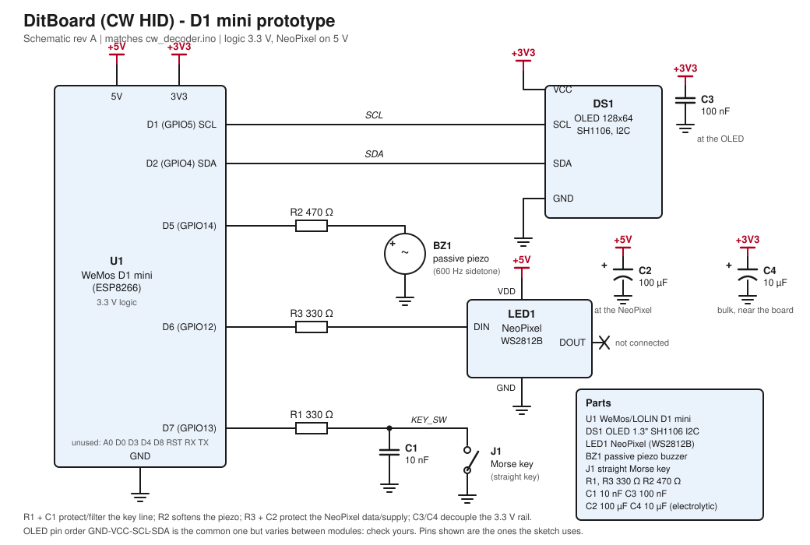

# DitBoard (CW HID)

**A straight-key Morse decoder with a "dit train" keying coach, heading for a USB keyboard.**

DitBoard is a straight Morse key connected to a **LOLIN/WeMos D1 mini (ESP8266)**. It gives instant
feedback (sidetone + LED), decodes what you key, and tells you **how well** you key by
comparing your timing with a steady reference beat, the *dit train*.

- Source: [`ditboard.ino`](ditboard.ino) (single file, heavily commented)
- This README holds the background: why it is built this way, how the algorithms work,
  what to watch out for.

> **Status.** The logic was syntax-checked against stub headers (including the Arduino
> IDE's prototype hoisting) and exercised in a PC simulation (a perfectly keyed and a
> sloppily keyed "A"). Behaviour on the real ESP8266, its timing, and the tuning
> constants have **not** been measured or tuned on hardware by the author of this
> document.

---

## 1. For AI assistants and quick readers

If you are asked to modify this project, these are the facts that matter:

| Topic | Fact |
|---|---|
| Time unit | microseconds from `micros()`; `dit` is the estimated dit length in **µs**; WPM = 1,200,000 / dit |
| Core idea | a free-running reference square wave (period = 2 dits). Down edges belong on even ticks, up edges on odd ticks. Quality = smoothed phase error of the edges against it |
| Control flow | one polling `loop()`; no interrupts, no RTOS, no long blocking calls |
| Display rule | drawing only fills the buffer and sets `dirty` bits; `serviceDisplay()` sends **one 8-px page per pass**, **only while the key is up** |
| Layout invariant | text pages (0..3) and trace pages (4..7) never share a page (`TRACE_Y` = 32) |
| History | `edges[]` ring buffer (32 records) feeds the trace; cleared when a new phrase locks |
| Arduino IDE trap | no function may have a user-defined type in its signature (prototype hoisting). `edgeIdx()` returns `int` for that reason |
| Order matters | `scoreEdge()` must run **before** `dit` is adapted; sidetone is switched **before** any slow work |
| Not implemented | USB HID (commands only echo text), paddle/iambic keying, Wi-Fi/Bluetooth |

Do not call anything slow (I²C, `delay()`, long loops) on the key-edge path.

---

## 2. What it does

- **Sidetone:** 600 Hz on a passive piezo while the key is down. The onboard LED lights too.
- **Decoder:** dots and dashes → characters, printed on Serial (115200 baud) and on the OLED.
- **Speed tracking:** the dit length adapts to your keying, shown as WPM.
- **Keying coach:**
  - the **NeoPixel blinks in the beat of the dit train** and its colour goes green → red with
    your phase error,
  - a **trace** on the OLED (after each character) shows your key under the reference,
  - the status row shows **WPM** and **Q %** (quality).
- **Command mode:** `<CMD>` (`-.-.-`) followed by one character selects a command
  (`U D L R H E X T N` = up, down, left, right, home, end, delete, tab, enter). For now
  these only echo as text; the plan is to turn them into USB keystrokes (see §9).

### Display

```
+--------------------------+
| CW 15 WPM  Q  87%        |  status row  (y 0..9)
| CQ CQ DE SM5SYO          |  text row 1  (21 columns)
| K                        |  text row 2
|                          |
|  ####......####......##  |  reference lane: where the key SHOULD be down
|  ##########.......####.  |  key lane:       where it really was down
+--------------------------+
```

Each decoded character is followed by a snapshot of about 21 dits. Keyed perfectly, every
key bar sits exactly under reference bars (a dit under one bar, a dah under bar-gap-bar).
In the sloppy case you see bars that start late, end early or are too long.

---

## 3. Hardware

Developed on the D1 mini; the code is plain Arduino and ports to other boards with minor
changes (see §9).

| Function | D1 mini pin | GPIO | Notes |
|---|---|---|---|
| Key | D7 | 13 | other terminal to GND; internal pull-up, LOW = pressed |
| Piezo (passive) | D5 | 14 | driven with `tone()` |
| NeoPixel DIN | D6 | 12 | 5 V supply, 3.3 V data (fine for one pixel on a short wire) |
| OLED SCL / SDA | D1 / D2 | 5 / 4 | SH1106 128×64 I²C; 3.3 V |
| Onboard LED | D4 | 2 | active low, no wiring |

Pins to avoid for the key and other inputs: D3 (GPIO0), D4 (GPIO2), D8 (GPIO15) are
boot-strapping pins.

### Optional discrete parts (recommended, none are required)

- NeoPixel: ~330 Ω in series with DIN, 100–470 µF across its 5 V/GND.
- Key line: 220–470 Ω in series with the GPIO and ~10 nF across the key terminals
  (ESD and RF pick-up).
- OLED: 100 nF across its supply; ~10 µF near the board.
- Piezo: 220 Ω–1 kΩ in series to tame a sharp tone.
- A debounce capacitor is **not** needed; debouncing is done in software (§5.1) and a
  large capacitor would skew the press/release timing that the coach measures.

### Schematic



The same drawing is in `ditboard_schematic.svg` (opens in any browser) and
`ditboard_schematic.png`. Only the pins the sketch uses are drawn.

### Build

1. Arduino IDE with the ESP8266 board package, board *LOLIN(WEMOS) D1 R2 & mini*.
2. Libraries: **U8g2** and **Adafruit NeoPixel**.
3. Open `ditboard.ino`, upload, open the Serial monitor at 115200 for the text stream.

If the OLED shows garbage or is shifted by a couple of pixels, the module is probably an
SSD1306: change the `u8g2` constructor accordingly.

---

## 4. Architecture

```
                 +---------------- loop() ---------------+
 key (D7) -----> | read key, timestamp (micros)          |
                 | blink NeoPixel in the reference beat  |
                 | on debounced edge:                    |
                 |    sidetone on/off, LED               |
                 |    scoreEdge(): phase error, quality  |
                 |    classify mark, adapt dit           |
                 | key up: timeouts -> flushChar()       |
                 |         serviceDisplay() (1 page)     |
                 +--------+---------------------+--------+
                          |                     |
                  decoder state           edges[] ring buffer
              (sym[], dit, anchor)        (t, anchor, dit, down)
                          |                     |
                 emit() -> Serial / OLED text    renderTrace() -> OLED trace
```

All state lives in globals; there is no dynamic allocation after start-up (apart from
the `std::map` Morse table built once).

---

## 5. How it works

### 5.1 Debounce

After an accepted edge, further changes are ignored for `DEBOUNCE_US` (3 ms). The edge
itself is timestamped immediately, so debouncing adds **no latency**. The cost: a
contact that bounces for longer than 3 ms produces stray edges. If you see stray `E` or
`I` characters, raise the constant to ~5 ms before adding hardware.

### 5.2 Decoding

- A mark longer than 2 dits is a dah, otherwise a dit (midpoint of 1 and 3).
- Dots and dashes accumulate in `sym[]` (max 15 elements; extras are dropped).
- **Character end:** gap longer than 2.5 dits → look up the pattern in `MORSE`
  (unknown → `?`).
- **Word end:** gap longer than 5 dits → emit a space (midpoint of 3 and 7).
- **Speed:** `dit = 0.8·dit + 0.2·(mark / 1 or 3)`, clamped to 25–400 ms
  (48–3 WPM). It starts at 80 ms (15 WPM). **Only marks** feed the estimate.
- Special table entries: `-...-` newline, eight dits backspace, `-.-.-` `<CMD>`.

### 5.3 The dit train (keying quality)

The idea, as originally described: imagine a sine wave whose period is two dits. The key
should go **down** when the wave goes negative and **up** when it goes positive again.
A dit lasts half a period; a dah one and a half periods.

Count in *ticks* (one tick = one dit). Everything is then an odd number of ticks apart:

```
tick:        0   1   2   3   4   5   6   7
reference:   #   .   #   .   #   .   #   .      # = "negative": key SHOULD be down
key  "A":    #   .   #   #   #   .
             dit gap dah-------
edges:       D0  U1  D2          U5              D = down edge, U = up edge
```

Marks are 1 or 3 ticks and gaps are 1, 3 or 7 ticks (all odd), so down edges always fall
on even ticks and up edges on odd ticks. Every edge can therefore be checked against the
nearest tick of the right parity with one subtraction.

**Scoring an edge** (`scoreEdge`):

1. expected time = anchor + ticks × dit (ticks = 1 or 3 for a mark; 1, 3 or 7 for a gap,
   classified by the 2-dit / 5-dit thresholds)
2. phase error `e` = (actual − expected) / dit, clipped to ±1 dit (+ = late)
3. quality `qErr` = running average of |e| (0.8 old + 0.2 new)
4. **phase loop:** the anchor moves `PHASE_GAIN` (25 %) of the way towards where the edge
   really was

Step 4 is the important design choice. A rigid reference would punish any constant speed
error forever; a reference that follows fully (gain 1) degenerates into judging each
element on its own. At 25 % the reference tracks slow drift and speed changes, while
rushing, dragging and uneven spacing remain visible as phase error.

The first key-down after a pause longer than `PAUSE_DITS` (10 dits) **locks** the phase:
the anchor is set to that edge and nothing is scored for it.

**Quality display:** `qErr` ≤ 0.10 dit is "good" (green, Q 100 %), ≥ 0.40 dit is "bad"
(red, Q 0 %), linear in between.

### 5.4 The NeoPixel

While the reference is running, the pixel is lit while the wave is "negative" (the key
should be down) and dark while it is "positive": a blink at the dit rate, locked to
your own keying. Its colour is the quality colour. Ten dits after your last key-up the
reference stops, the pixel switches off and the quality resets.

`pixel.show()` disables interrupts for a few tens of µs, so the pixel is only written
when its state changes (or when the colour must be refreshed after an edge).

### 5.5 The OLED

The display is driven in **full-buffer** mode, but sent in pieces:

- Drawing functions only change the RAM buffer and mark 8-pixel *pages* dirty.
- `serviceDisplay()` sends the lowest dirty page (128 bytes, roughly 3 ms at 400 kHz)
  and is called **once per loop pass, only while the key is up**.
- The text area (pages 0..3) and the trace (pages 4..7) never share a page.

Trace rendering (`renderTrace`) walks the 128 pixel columns left to right. Each column
maps to a time (6 px per dit, window ending when the character was flushed). The
reference lane is evaluated from the stored segment that applies at that time, with
that segment's own dit and parity; the key lane from the stored real edge times. The
picture therefore shows what the decoder used, including its phase corrections.

---

## 6. Tunable constants

| Constant | Default | Effect |
|---|---|---|
| `TONE_HZ` | 600 | sidetone pitch |
| `DEBOUNCE_US` | 3000 | lockout after an edge; raise for bouncy keys |
| `PHASE_GAIN` | 0.25 | how far the reference follows each edge (0 rigid … 1 full) |
| `Q_GOOD` / `Q_BAD` | 0.10 / 0.40 | phase error (dits) mapped to green / red |
| `PAUSE_DITS` | 10 | idle time after which the reference stops and re-locks |
| `dit` start value | 80000 µs | initial speed assumption (15 WPM) |
| `dit` clamp | 25–400 ms | speed range 48–3 WPM |
| thresholds in code | 2 / 2.5 / 5 dits | dit-dah, end of character, end of word |
| `PX_PER_DIT` | 6 | trace time scale |
| `setBrightness` | 40 | NeoPixel brightness (0–255) |
| `DISPLAY_FONT`, `CHAR_W`, `ROW_H`, `ROWS` | 6x10, 6, 10, 2 | text geometry; change together |

The quality constants and `PHASE_GAIN` are first guesses.

---

## 7. Design decisions and why

| Decision | Reason | Alternative rejected |
|---|---|---|
| Quality against a partly-following reference | catches drift, rushing and dragging; matches the "sine wave" mental model | scoring each element against ideal 1:3:7 ratios in isolation (blind to drift) |
| Speed from marks only | gaps vary with personal style or Farnsworth spacing; using them would corrupt the speed | estimating from all elements |
| Polling loop | simplest, easy to reason about | interrupt-driven edge capture (more precise, more complex) |
| One page per pass, key-up only | bounds the delay a display update can cause to one page (~3 ms) and never delays a release | one big `sendBuffer()` (~25 ms stall) |
| Trace after each character, not live | live redraw would disturb the timing it measures | continuously scrolling trace |
| Edge history in a ring buffer | trace shows what the decoder actually used | reconstructing the reference afterwards |
| Software debounce (lockout) | zero added latency, no timing skew | RC filter on the key line |
| `tone()` for the sidetone | timer-driven, no CPU cost in the loop | PWM via `analogWrite()` (wrong default frequency) |
| `std::map` Morse table | readable, easy to extend | switch/if chains |
| Sidetone switched before slow work | the sound should never lag the key | updating display first |

---

## 8. Known limitations and things to know

- **Straight key only.** No paddle or iambic logic.
- **Timing jitter on presses:** if a display page is in flight when the key is pressed,
  the press is timestamped up to ~3 ms late (about 6 % of a dit at 25 WPM). Releases are
  not affected. An interrupt-based timestamp would remove this.
- **Software floating point** on the ESP8266: `renderTrace()` takes an estimated
  1–2 ms (not measured). It runs when a character is flushed, i.e. in a gap.
- **Start-up assumption:** 15 WPM until the estimate adapts; the first characters at very
  different speeds can be misclassified.
- **Unusual spacing** (e.g. Farnsworth) shows up as phase error, by design.
- **Backspace** on the display only removes a character on the current row.
- **Commands** are placeholders; prosigns after `<CMD>` map to `<?>` because only the first
  character of the decoded item is used.
- **Overflow:** more than 15 elements in one character are dropped silently, which usually
  decodes as `?`.
- `micros()` wraps after ~71 minutes; unsigned differences make this harmless, and the
  edge history is cleared at every new phrase so old timestamps never get compared.
- Prototypes: see the Arduino IDE note in §1.

---

## 9. Porting and next steps

- **USB HID:** the D1 mini has no USB device. An RP2040 board (Pico / RP2040-Zero) with the
  Arduino-Pico core can act as keyboard and serial port at the same time; `sendCommand()`
  would call `Keyboard.write(...)`. Port notes: pins become `GPxx`, set the I²C pins with
  `Wire.setSDA/SCL`, `LED_BUILTIN` works on the Pico. Hardware I²C there is faster, which
  shrinks the page time to about 1 ms.
- **Interrupt-driven edge timestamps** to remove the press jitter completely.
- **Tuning on a real key:** `PHASE_GAIN`, `Q_GOOD`, `Q_BAD`, `DEBOUNCE_US`.
- **Optional:** blend in phase against an audible metronome, paddle/iambic mode, a
  larger font (needs fewer columns/rows), persistent settings.

---

## 10. File map

| File | Contents |
|---|---|
| `ditboard.ino` | the whole firmware, section by section: pins → Morse table → decoder state → dit train and quality → edge history → display → trace → commands → `setup()`/`loop()` |
| `README.md` | this document |
| `ditboard.svg` / `.png` | circuit diagram of the D1 mini prototype |
