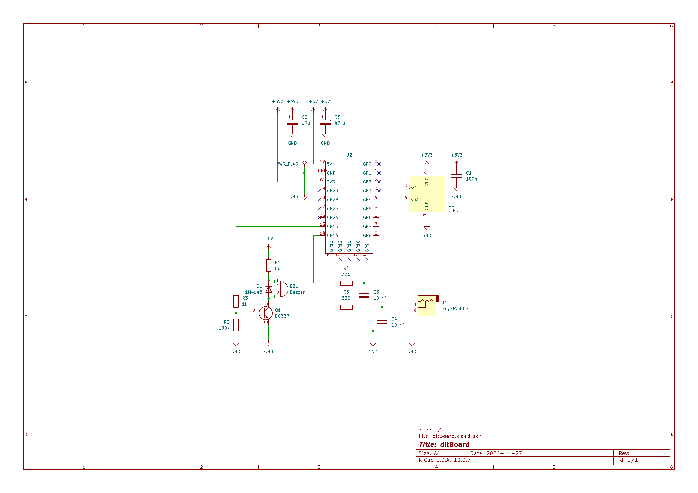

# DitBoard (CW HID)

**A straight-key Morse USB keyboard with a "dit train" keying coach.**

DitBoard is a Morse key connected to a **Waveshare RP2040-Zero**. It gives instant feedback
(sidetone and a light), decodes what you key, and tells you **how well** you key by comparing your
timing with a steady reference beat, the *dit train*. The RP2040's native USB types decoded text and
sends navigation/editing keys as a USB keyboard ("HID"), while Serial and the OLED retain local feedback.
It **starts offline**, with a slow blue blink and no USB keystrokes. Key `VVV` in one word to go online;
key the prosign `<SK>` (`...-.-`) to go offline again.

This document is self-contained: purpose, hardware, wiring, how the firmware works, the design
decisions, the limitations and the things to check. The same drawing and the firmware are in this folder:

- `ditboard_rp2040zero.ino`: the firmware (one file, heavily commented)
- `ditboard_rp2040zero_schematic.png`: the circuit diagram

The PNG schematic is the authoritative **as-built hardware reference**. Component references and
as-built values below follow that drawing. The installed OLED is confirmed as a 128×64 SH1106,
and the fitted 68 Ω buzzer resistor (R1) is rated ½ W.

> **Status.** The hardware has been built and works (with R1 = 68 Ω). The decoding logic, the display
> paging and the compact trace layout were syntax-checked against stub headers (including the Arduino IDE's
> prototype hoisting) and exercised in a PC simulation (a perfectly keyed and a sloppily keyed "A"). The
> compact 24-pixel trace layout, the timing constants (`PHASE_GAIN`, `Q_GOOD`, `Q_BAD`) and the real-world
> timing have **not** been measured or tuned on the real hardware by the author of this document.
> The dual-core firmware builds for the RP2040 Zero. Host regressions cover speed confidence,
> random tapping, sustained speed changes, core ownership, queued snapshots, USB routing and offline controls;
> physical timing and USB delivery still require testing on the board.

---

## 1. For AI assistants and quick readers

If you are asked to modify this project, these are the facts that matter:

| Topic | Fact |
|---|---|
| Time unit | microseconds from `micros()`; `dit` is the estimated dit length in **µs**; WPM = 1,200,000 / dit |
| Core idea | a free-running reference square wave (period = 2 dits). Down edges belong on even ticks, up edges on odd ticks. Quality = smoothed phase error of the edges against it |
| Control flow | core 1 polls the key in `loop1()` and owns decoding, sidetone and NeoPixel; core 0 owns USB, Serial and OLED in `loop()` |
| Cross-core rule | an 8-event SDK queue carries copied snapshots; an atomic keyboard session token gates HID independently of queue capacity. Never access another core's mutable decoder state or wait for queue space |
| Display rule | drawing only fills the buffer and sets `dirty` bits; core 0 sends **one 8-px page per pass**, independently of the key |
| Speed tracking | 7 of 8 raw marks must fit a common 1:3 dit/dah ratio; three confirmations need fresh windows; trusted dit changes by at most 3% per accepted mark |
| Layout invariant | text pages (0..4) and trace pages (5..7) never share a page (`TRACE_Y` = 40, a multiple of 8) |
| History | `edges[]` ring buffer (32 records) feeds the trace; cleared when a new phrase locks |
| Arduino IDE trap | generated prototypes can precede custom type declarations; keep free-function signatures primitive or provide correctly placed declarations. `edgeIdx()` returns `int` for that reason |
| Order matters | `scoreEdge()` must run **before** `dit` is adapted; the sidetone is switched **before** any slow work |
| Hardware ahead of firmware | the jack's ring input (GP13, paddles) is wired but **not read** yet |
| USB HID | Pico SDK USB stack; US keyboard layout; queued press/release reports, serviced without `Keyboard.write()` delays |
| Keyboard safety gate | boot offline; `VVV` in one word enables HID, `<SK>` disables it; offline LED is blue, 1 second on / 1 second off |
| Not implemented | paddle/iambic keying, Wi-Fi/Bluetooth |

Do not call anything slow (I²C, `delay()`, long loops) on the key-edge path.

---

## 2. What it does

- **Sidetone:** 600 Hz on a magnetic buzzer while the key is down. An optional external LED can show
  key-down too (`LED_PIN`; the board itself has no plain LED).
- **Decoder:** dots and dashes → characters, printed on Serial (115200 baud) and on the OLED; typed over USB only online.
- **Offline/online:** startup is offline. Three consecutive decoded `V` characters (`...-` each) in one word
  activate USB output. Another character or a word gap (over five estimated dits) resets a partial activation.
  `<SK>` (`...-.-`) takes it offline, even during command mode. The activation/deactivation signals remain
  visible locally but are never typed, and their trailing word spaces are suppressed. Ordinary `V`s type normally online.
  Sidetone, local decoding, speed tracking, quality scoring and the OLED trace remain available offline.
- **Speed tracking:** the dit length follows sustained, consistent mixed dit/dah keying, shown as WPM.
  Erratic tapping and isolated malformed marks do not directly pull the speed estimate around.
- **Keying coach:**
  - online, the board's **RGB LED (a WS2812 "NeoPixel" on GP16) blinks in the beat of the dit train**;
    its colour goes green → red with your phase error. Offline, it instead blinks blue, one second on / one second off,
  - after each character a **trace** on the OLED shows your key and, in a thin strip below it, the dit train,
  - the status row shows **WPM** and **Q %** (quality).
- **Command mode:** `<CMD>` (`-.-.-`) followed by one character selects a command
  (`U D L R H E X T N` = up, down, left, right, home, end, delete, tab, enter). These send real USB keys only online;
  labels such as `<UP>` appear only on Serial/OLED. Unknown commands show `<?>` locally and send no USB key.
  Command mode stays armed across pauses; there is currently no idle timeout. Switching offline/online clears it.
- **Special Morse entries:** `-...-` (BT) = newline, eight dits = backspace (removes a character on the
  current display row only). Online, newline and backspace also send Enter and Backspace to the host;
  prosigns `<AR> <KN> <AS>` are shown and typed as literal text. `<SK>` is the offline control, not literal USB text.

### The display (128×64 OLED, SH1106)

The status row begins with `OFF` while offline and `CW` while online. WPM and Q remain local feedback in both modes.

```
+--------------------------+
| CW 15 WPM  Q  87%        |  status row     (y 0..9)
| CQ CQ DE SM5ABC          |  text row 1     (21 columns, y 10..19)
| PSE K                    |  text row 2     (y 20..29)
|                          |  text row 3     (y 30..39)
|  ######....##########..  |  key lane       (y 41..54): where the key really was down
| ------------------------ |  baseline       (y 55)
|  ######....######..####  |  dit-train strip (y 57..60): where it SHOULD have been down
+--------------------------+  baseline       (y 61)
```

After each decoded character the trace shows about 21 dits (6 px per dit at any speed). Keyed perfectly, every
key bar sits exactly above reference bars: a dit above one bar, a dah above bar-gap-bar. Early, late, short or
long elements show up as misalignment. The reference strip is deliberately thin: it only has to show *where the
key should have been down*, and it leaves room for three text rows.

---

## 3. Hardware overview



| Block | What | Notes |
|---|---|---|
| U2 | Waveshare RP2040-Zero | dual-core RP2040, 264 kB RAM, 2 MB flash, USB-C, WS2812 RGB LED on GP16; CPU clock follows the selected board-menu setting |
| U1 | OLED, 128×64, SH1106, I²C | powered from the 3V3 pad |
| J1 | 3.5 mm stereo jack | tip = key / dit, ring = dah, sleeve = GND |
| BZ1 | magnetic buzzer | coil measured 15.2 Ω, rated 1.5-15 V |
| Q1, R1, R2, R3, D1 | buzzer driver | see §6 |
| R4, R5, C3, C4 | jack input protection | see §5 |
| C1, C2, C5 | decoupling | see §7 |

### Pin reference

| Function | RP2040-Zero pad | Notes |
|---|---|---|
| Key / dit paddle (jack tip) | GP14 | internal pull-up, LOW = closed |
| Dah paddle (jack ring) | GP13 | wired, **not configured or read by the firmware yet** |
| Buzzer drive | GP15 | `tone()` square wave into the transistor base |
| OLED SDA / SCL | GP4 / GP5 | I²C0, the Arduino-Pico default pair |
| Quality indicator | GP16 | the onboard WS2812; no wiring |
| Key-down LED | none | board has no plain LED; set `LED_PIN` for an external one |
| 3.3 V | 3V3 pad | OLED supply |
| 5 V | 5V pad | buzzer supply (USB 5 V) |

The pad names are printed on the board. Any edge GPIO would do; these were chosen arbitrarily. To use other
pins, change the constants at the top of the sketch (I²C pins must form a valid I²C0 pair: SDA on GP0, 4, 8
or 12 and SCL on GP1, 5, 9 or 13; I²C1 pairs would need `Wire1`).

### Parts list

| Ref | Value | Role |
|---|---|---|
| R1 | 68 Ω, ½ W | buzzer current / volume |
| R2 | 100 kΩ | base pull-down of Q1 |
| R3 | 1 kΩ | base resistor of Q1 |
| R4, R5 | 330 Ω | series protection of the tip and ring inputs |
| C1 | 100 nF | decoupling at the OLED supply |
| C2 | 10 µF | bulk on the 3.3 V rail near the board |
| C3, C4 | 10 nF | filter on the tip and ring inputs |
| C5 | 47 µF | bulk on the 5 V rail at the buzzer |
| Q1 | BC337 | NPN switch for the buzzer |
| D1 | 1N4148 | flyback diode across the buzzer coil |

---

## 4. The stereo jack: key and paddles on the same socket

| Plug in the jack | Tip | Ring | Sleeve |
|---|---|---|---|
| **Mono plug**, classic straight key | key | shorted to sleeve by the plug body (ring reads LOW) | GND |
| **Stereo plug**, paddles | dit paddle | dah paddle | common (GND) |

- Each input goes to its GPIO through 330 Ω (R4/R5), with 10 nF (C3/C4) to GND. The firmware enables the
  tip input's internal pull-up; the ring input is not configured yet. The key or paddle simply connects
  the contact to the sleeve (GND) when closed.
- With the classic key on a **mono** plug the ring is grounded by the plug, so the ring input reads LOW all the
  time. That is harmless today (the firmware ignores the ring) and useful later: ring LOW at idle means
  "straight key", ring HIGH at idle means "paddles" once its pull-up is enabled.
- Some paddles are wired the other way round (tip = dah). Swap them in software, or swap the wires.
- Jacks differ in pin order and in switch contacts; check yours against the T / R / S labels in the schematic.

**Firmware work still to do:** enable the ring pull-up and read the input, detect straight key vs paddles
from its idle level, and add iambic keying (timed dits and dahs, squeeze handling). The decoder and the quality
coach would then follow the generated elements instead of the raw key timing.

---

## 5. Why these protection parts, and why no debounce capacitor

- **R4 + C3 and R5 + C4** (330 Ω in series, 10 nF to GND on each jack input) protect the pins from static
  through a handled cable and filter RF pick-up from a nearby transmitter. With the internal pull-up
  (tens of kΩ), 10 nF gives a time constant of a few hundred microseconds. This is small relative to
  a dit, but is not zero and can affect the observed edge timing.
- **No large debounce capacitor.** Debouncing is done in software (§10.2); a big capacitor would skew the press and
  release times that the coach measures.

---

## 6. The buzzer stage

The buzzer is a magnetic one (a coil measuring 15.2 Ω, not a piezo disc). A GPIO pin can supply only a few mA
(4 mA by default, 12 mA at most), so a transistor switches the coil:

```
                        +5V (5V pad)
                        |
                 [R1 68 Ω, ½ W]
                        |
           +------------+-----------+
           |                        |
      BZ1 coil (15.2 Ω)          D1 1N4148
           |                    (cathode up)
           |                        |
           +------------+-----------+
                        |
                        C
 GP15 --[R3 1k]--+------B Q1 BC337
                 |      E
             [R2 100k]  |
                 |      |
                GND    GND
```

| Part | Value | Why |
|---|---|---|
| Q1 | BC337 (or 2N2222 / 2N3904) | NPN low-side switch; handles a few hundred mA with a 2-3 mA base current |
| R3 | 1 kΩ | base current of about (3.3 V - 0.75 V) / 1 kΩ = 2.5 mA, within the pin's default 4 mA |
| R2 | 100 kΩ | keeps Q1 off while the GPIO floats during reset and boot |
| D1 | 1N4148 | absorbs the coil's voltage spike when Q1 turns off; cathode to buzzer + after R1, anode to the collector |
| R1 | 68 Ω as built, ½ W | sets the volume and limits the coil current |

- **Pinouts differ.** The BC337 is C-B-E, the 2N2222 and 2N3904 are E-B-C (flat side towards you, leads down).
  Check the datasheet of the exact part you use. The 2N2907 is a PNP transistor and is not suitable here.
- **Why 5 V:** the buzzer is rated 1.5-15 V, so 5 V is well inside its range, and taking the supply from the 5 V
  pad keeps the coil's current pulses off the small 3.3 V regulator that feeds the RP2040 and the OLED. The 5 V
  comes straight from USB, so the board must be powered over USB.
- **Currents (estimates, 5 V, saturated transistor, Vce about 0.2-0.3 V):** with R1 = 68 Ω the coil gets roughly
  57 mA at full voltage, and about half that on average at 600 Hz. Lower R1 for more volume;
  keep it at 22 Ω or more (about 130 mA peak), which also keeps the USB draw and the heat in the coil modest. R1
  dissipates up to about 0.25 W while the transistor is on, so use a ½ W part (a ¼ W part is borderline).
- **Why a magnetic buzzer needs the transistor:** driven directly through a series resistor from a GPIO it only
  sounds weak (a 470 Ω resistor was too quiet, 22 Ω acceptable), and a bare 15 Ω coil on a pin would try to draw
  more than the pin is designed for.
- **Idle level of GP15 must be LOW.** A HIGH level would energise the coil continuously. R2 covers reset and boot;
  during normal running `noTone()` should leave the pin LOW. Measure GP15 with a meter when the key is up; if it
  is not 0 V, add `digitalWrite(BUZZER, LOW)` after `noTone()` in the sketch.

---

## 7. Supply and decoupling

- **C1 (100 nF) at the OLED** and **C2 (10 µF) on the 3.3 V rail**: a small ceramic supplies fast current
  spikes right at the module (it has to sit at the module's VCC/GND pins, not at the board); the larger
  capacitor covers slower swings. Most OLED modules carry their own small capacitors, so C1 is cheap insurance,
  more important with long jumper wires.
- **C5 (47 µF)** on the 5 V rail near the buzzer smooths its current pulses.
- The RGB LED is on the board and needs no external supply wiring.

---

## 8. Building it

### Lead colours

| Lead colour | Signal | From (RP2040-Zero pad) | To |
|---|---|---|---|
| black | GND | GND | OLED GND, Q1 emitter, R2, jack sleeve |
| red | +5 V | 5V pad | buzzer + (through R1) |
| orange | +3.3 V | 3V3 | OLED VCC |
| blue | SDA | GP4 | OLED SDA |
| yellow | SCL | GP5 | OLED SCL |
| purple | buzzer drive | GP15 (through R3, 1 kΩ) | Q1 base |
| brown | buzzer - | Q1 collector | buzzer - |
| green | tip (key / dit) | GP14 (through R4, 330 Ω) | jack tip |
| white | ring (dah) | GP13 (through R5, 330 Ω) | jack ring |

The colours are a suggestion: keep 5 V and 3.3 V visibly different (some modules tolerate 5 V, others do not),
use the same colour at both ends of each wire, and do not rely on red against green alone as a clue (red-green
colour blindness).

### Wire and connectors

- **Stranded wire** for everything in the finished box, especially the key cable (it gets handled): it survives
  bending and vibration, whereas solid wire work-hardens and breaks at the bend. Silicone-insulated 26-28 AWG
  (about 0.1-0.15 mm²) is easy to route for signals; use 24 AWG for GND and 5 V if the runs are long.
- **Solid wire** only for breadboard prototyping.
- Pre-tin stranded ends that go onto a solder joint. Do not pre-tin ends that are crimped (Dupont) or
  screwed into a terminal: solder under a crimp or a screw loosens over time.
- **Strain relief** where the key cable enters the box: a clamp or a knot just inside, so a tug pulls on the
  clamp and not on the solder joint. This matters more than solid versus stranded.
- The board has castellated edges: for prototyping, buy the version with pin headers. USB-C is much sturdier than
  micro-USB, but still support the cable so the connector is not levered.

### Before first power-up

Use a multimeter in continuity mode: GND, 5 V and 3.3 V go where they should, and the 5 V and 3.3 V wires do not
touch each other. Check the transistor's pinout against its datasheet.

---

## 9. Software setup

1. Arduino IDE with the Arduino-Pico core by Earle F. Philhower, III (add the board index URL
   `https://github.com/earlephilhower/arduino-pico/releases/download/global/package_rp2040_index.json` under
   *Preferences > Additional boards manager URLs*, then install **Raspberry Pi Pico/RP2040/RP2350**).
2. Board: **Waveshare RP2040 Zero**.
3. **Tools > USB Stack > Pico SDK**. The core's built-in **Keyboard** library is used; do not select
   Adafruit TinyUSB or No USB.
4. Libraries: **U8g2** and **Adafruit NeoPixel**.
5. First upload: hold **BOOT** while plugging in the USB-C cable. Use a data cable; a charge-only cable makes the
   board power up but never show up.
6. Serial monitor at 115200 for the text stream (the baud rate is not used by native USB).
7. Select a **US keyboard layout** on the host so punctuation matches. Open a blank text editor and focus it
   before going online: decoded input goes to the focused application, including Enter and editing commands.
8. The LED initially blinks blue. Key `VVV` without word gaps to enable USB keystrokes; key `<SK>` (`...-.-`) to disable them.

USB output uses a 32-key queue on core 0 and sends at most one press or release report per loop pass, only when
the endpoint is ready. The USB keyboard interface still enumerates at startup; offline mode gates keystrokes,
not device enumeration. Releases are serviced even while the Morse key is down.
Every offline/online transition invalidates queued USB keys and events from older keyboard sessions.
Offline events and the mode-control signals cannot become USB input after activation. A USB key already
pressed is released as soon as the endpoint is ready, including while offline.
Keys are dropped if USB is unmounted when core 0 processes the output event; pending USB keys are
cleared when core 0 observes a disconnect. The separate cross-core event queue is not cleared by
disconnects, so an eligible event still waiting there can be typed after reconnection if its online session
has not changed. A USB disconnect alone does not change mode; restarting the board always returns offline.
Queue overflow and dropped keys are reported on Serial; Serial/OLED decoding continues independently.

The sketch folder must be named like the file: `ditboard_rp2040zero\ditboard_rp2040zero.ino`. Do not keep another
`.ino` file in the same folder: the IDE builds every `.ino` in a folder together, and duplicate definitions give
"redefinition" errors.

---

## 10. How the firmware works

### 10.1 Architecture

```
 key (GP14) ---> Core 1: setup1() / loop1()
                 key polling and microsecond timestamps
                 sidetone, optional LED, NeoPixel
                 decoding, phase quality, trusted speed
                 character/word timeouts, VVV/SK mode controls
                            |
                 bounded queue: copied output events
                 text/command + WPM/Q + edge snapshot + session/USB eligibility
                            |
                 Core 0: setup() / loop()
                 Serial and session-gated USB keyboard output
                 OLED text/status/trace rendering
                 one display page per pass
```

Each core owns its mutable state and peripherals. Core 0 initializes the output queue and display, then
publishes an atomic ready flag before core 1 starts key polling. `core1_separate_stack = true` retains
an 8 KB stack on each core. The SDK queue copies events under its short internal lock; neither core
holds that lock during peripheral operations. Core 1 uses `queue_try_add()`, never a blocking enqueue.

The queue holds eight output events. If core 0 falls behind, core 1 keeps timing and decoding; dropped
events are counted atomically, reported on Serial, and marked `<OVF>` on the OLED (not typed over USB).
Trace rendering uses the event's captured timestamp and copied edges, not the decoder's newer state.
Core 1 also publishes an atomic session token on each offline/online transition (odd = online, even = offline).
Core 0 drops pending USB keys on token changes and only sends eligible events from the current online session.
This keeps shutdown effective even if its display event is dropped, and prevents stale output from an earlier
online session leaking through a rapid offline/online cycle.
Globals, the Morse table, queue storage and core stacks are initialized at start-up.

### 10.2 Debounce

After an accepted edge, further changes are ignored until more than `DEBOUNCE_US` (3 ms) has elapsed.
Outside that lockout, a change is accepted and timestamped when polled, without an additional settling delay.
A level change during the lockout is accepted later only if the new level is still present; a short pulse
can be missed. Contact bounce lasting longer than the lockout can produce stray edges. If you see stray
`E` or `I` characters, raise the constant to about 5 ms before adding hardware.

### 10.3 Decoding

- A mark longer than 2 dits is a dah, otherwise a dit (midpoint of 1 and 3).
- Dots and dashes accumulate in `sym[]` (max 15 elements; extras are dropped silently). The truncated
  15-element pattern has no entry in the current Morse table, so an overlong character decodes as `?`.
- **Character end:** gap longer than 2.5 dits → look up the pattern in the Morse table (unknown → `?`).
- **Word end:** gap longer than 5 dits → emit a space (midpoint of 3 and 7).
- **Speed:** starts at 80 ms (15 WPM), with a trusted dit length clamped to 25-400 ms (48-3 WPM).
  **Only marks** feed the estimate; see the confidence rules below.
- After `<CMD>` the next decoded non-`<CMD>` item normally selects a command; only its first character is used,
  so other prosigns map to `<?>`. `<SK>` always takes the keyboard offline instead. Another `<CMD>` rearms
  command mode. Pauses do not cancel it, because command mode suppresses the word-space timeout;
  an offline/online mode transition clears it.

#### Confidence-based speed adaptation

The last eight raw mark lengths are fitted independently of the decoder's current dit/dah classification.
Each mark supplies a trial dit length, either directly (dit) or divided by three (dah). At least seven normalized
marks must match a trial within 15%, with at least two matching dits and two matching dahs.
The fit with most matches wins, breaking ties by lowest total relative error; its mean normalized
inlier duration becomes the candidate. A candidate must remain within 10% across three
confirmations, with eight fresh marks between confirmations: acquisition needs at least 24 marks.

Once confirmed, each new matching mark moves the trusted dit 20% towards the candidate, capped
at a 3% change in dit length per update. An outlier does not update speed; inconsistent windows
discard confidence without changing the trusted speed. The quality score does not gate adaptation,
so a genuine speed change can still be acquired even when it initially scores poorly.

An idle gap over four seconds clears pending speed evidence, but retains the trusted speed.
This uses ten times the longest supported dit, rather than the current dit, so a large slowdown's
normal character gaps do not continually reset acquisition. Gaps never supply speed samples.
Repeated single-length marks are ambiguous (slow dits or faster dahs) and cannot establish a new speed.

### 10.4 The dit train (keying quality)

The idea: imagine a sine wave whose period is two dits. The key should go **down** when the wave goes negative
and **up** when it goes positive again. A dit lasts half a period; a dah one and a half periods.

Count ideal timing in *ticks* (one tick = one dit). Successive expected edges are an odd number of ticks apart:

```
tick:        0   1   2   3   4   5   6   7
reference:   #   .   #   .   #   .   #   .      # = "negative": key SHOULD be down
key  "A":    #   .   #   #   #   .
             dit gap dah-------
edges:       D0  U1  D2          U5              D = down edge, U = up edge
```

In ideal timing, marks are 1 or 3 ticks and gaps are 1, 3 or 7 ticks (all odd), so expected down edges
fall on even ticks and expected up edges on odd ticks. The firmware classifies the mark or gap first,
then compares the edge with that class's expected time; it does not search arbitrary nearby ticks.

**Scoring an edge** (`scoreEdge`):

1. expected time = anchor + ticks × dit (ticks = 1 or 3 for a mark; 1, 3 or 7 for a gap, classified by the
   2-dit / 5-dit thresholds)
2. phase error `e` = (actual − expected) / dit, clipped to ±1 dit (+ = late)
3. quality `qErr` = running average of |e| (0.8 old + 0.2 new)
4. **phase loop:** the anchor moves by `PHASE_GAIN` (25 %) of the clipped error, at most 0.25 dit per edge

Step 4 is the important design choice. A rigid reference would retain accumulated phase offsets; a
reference that follows fully (gain 1) follows the actual edge when the error is within the clipping range.
Larger errors still have bounded corrections. At 25 % the reference tracks slow drift and speed changes,
while rushing, dragging and uneven spacing remain visible as phase error.

The first key-down after a pause longer than `PAUSE_DITS` (10 dits) **locks** the phase: the anchor is set to that
edge and nothing is scored for it.

**Quality display:** `qErr` ≤ 0.10 dit is "good" (green, Q 100 %), ≥ 0.40 dit is "bad" (red, Q 0 %), linear in
between.

### 10.5 The RGB LED

Offline, the LED blinks **blue for one second, then off for one second**, independent of keying, quality and
reference timeouts. It does not show quality colours until `VVV` activates the keyboard. `<SK>` immediately
restarts the offline blink with blue on.

Online, while the reference is running, the LED is lit while the wave is "negative" (the key should be down)
and dark while it is "positive": a blink at the dit rate, locked to your own keying. Its colour is the quality
colour. Ten dits after the last key-up the reference stops and quality resets; the LED then stays off online,
but continues its independent blue blink offline.

NeoPixel output runs on core 1. The installed library uses RP2040 PIO and briefly masks that core's
interrupts while feeding it; `show()` can also wait for the LED's latch interval. Calls are avoided unless
the on/off state changes or the colour needs refreshing. These costs are library-dependent and unmeasured.
The brightness is capped at 40 of 255: the LED is close to your eyes and bright. It is on the board itself,
so the box needs a window or a light pipe over it. If red and
green look swapped, change `NEO_GRB` to `NEO_RGB`.

### 10.6 The OLED

The display is driven in **full-buffer** mode, but sent in pieces:

- Drawing functions only change the RAM buffer and mark 8-pixel *pages* dirty.
- `serviceDisplay()` sends the lowest dirty page (128 bytes, roughly 3 ms at 400 kHz) and is called **once per
  core 0 loop pass**, even while the key is down. Core 1 continues polling independently.
- The text area (pages 0..4) and the trace (pages 5..7) never share a page.

Trace rendering (`renderTrace`) walks the 128 pixel columns left to right. Each column maps to a time (6 px per
dit, window ending when the character was flushed). The reference strip is evaluated from the stored segment that
applies at that time, with that segment's own dit and parity; the key lane from the stored real edge times. The
picture uses the recorded edge times, reference anchors and dit estimates, including phase corrections.
Mark-release records are captured before speed adaptation; the trace does not record every subsequent
live-reference speed update between edges.

---

## 11. Tunable constants

| Constant | Default | Effect |
|---|---|---|
| `TONE_HZ` | 600 | sidetone pitch |
| `DEBOUNCE_US` | 3000 | lockout after an edge; raise for bouncy keys |
| `PHASE_GAIN` | 0.25 | how far the reference follows each edge (0 rigid … 1 full) |
| `Q_GOOD` / `Q_BAD` | 0.10 / 0.40 | phase error (dits) mapped to green / red |
| `PAUSE_DITS` | 10 | idle time after which the reference stops and re-locks |
| `dit` start value | 80000 µs | initial speed assumption (15 WPM) |
| `dit` clamp | 25-400 ms | speed range 48-3 WPM |
| `SPEED_WINDOW` / `SPEED_INLIERS` | 8 / 7 | recent marks / minimum matching marks, including two dits and two dahs |
| `SPEED_CONFIRM` | 3 | confirmations, separated by a fresh window of marks |
| `SPEED_TOLERANCE` / `SPEED_CANDIDATE_TOLERANCE` | 0.15 / 0.10 | mark-fit / candidate consistency tolerance |
| `SPEED_GAIN` / `SPEED_MAX_STEP` | 0.20 / 0.03 | candidate smoothing / maximum dit change per matching mark |
| `OUTPUT_N` | 8 | copied output events queued between cores |
| `OFFLINE_BLINK_US` | 1000000 | each on/off interval of the offline blue blink |
| thresholds in code | 2 / 2.5 / 5 dits | dit-dah, end of character, end of word |
| `PX_PER_DIT` | 6 | trace time scale |
| `ROWS`, `TRACE_Y`, `KEY_Y/H`, `REF_Y/H` | 3, 40, 41/14, 57/4 | display geometry (keep `TRACE_Y` a multiple of 8) |
| `setBrightness` | 40 | RGB LED brightness (0-255) |
| `LED_PIN` | -1 | set to a pin for an external key-down LED |
| `DISPLAY_FONT`, `CHAR_W`, `ROW_H` | 6x10, 6, 10 | text geometry; change together |

The quality constants and `PHASE_GAIN` are first guesses.

---

## 12. Design decisions and why

| Decision | Reason | Alternative rejected |
|---|---|---|
| Quality against a partly-following reference | catches drift, rushing and dragging; matches the "sine wave" mental model | scoring each element against ideal 1:3:7 ratios in isolation (blind to drift) |
| Confident speed from mixed marks only | erratic keying should reduce quality, not drag WPM down; fresh confirmations avoid reusing accidental patterns | updating speed from every mark or from gaps |
| Dedicated polling core | isolates key timing from USB, Serial and I2C work with clear ownership | shared single-core polling; interrupt capture remains a possible refinement |
| Copied events in a bounded SDK queue | no races on decoder/display state and no wait for output capacity | shared mutable globals or blocking output from the timing core |
| Boot-offline keyboard gate with session tokens | requires deliberate activation; mode changes invalidate queued HID input without relying on queue space | always-on keyboard or a boolean gate that can replay stale events after reactivation |
| One display page per core 0 pass | keeps USB output responsive without delaying core 1 | one big `sendBuffer()` |
| Trace snapshot after each character | retains the decoded character's timing even when output is delayed | rendering from mutable live decoder state |
| Compact trace: key lane + thin reference strip | frees 8 px for a third text row (50 % more characters) while still showing misalignment | two full-height lanes; a dotted overlay (noisy on a 1-bit 128×64 display, needs XOR drawing) |
| Edge history in a ring buffer | retains key timestamps and per-edge reference values for the trace | reconstructing the reference afterwards |
| Software debounce (lockout) | no extra settling wait outside the lockout; short transitions during it can be lost or deferred | a large RC debounce filter on the key line |
| `tone()` for the sidetone | Arduino-Pico uses PIO for the waveform; start/stop still have processing costs | bit-banging the pin in `loop1()` |
| `std::map` Morse table | readable, easy to extend | switch/if chains |
| Sidetone switched before slow work | the sound should never lag the key | updating display first |
| Transistor-driven magnetic buzzer from 5 V | the coil needs far more current than a pin can give; keeps pulses off the 3.3 V regulator | driving it from a GPIO through a resistor (weak) |
| Onboard RGB LED as quality indicator | no external part, no 5 V wiring, no level issue | external NeoPixel |
| Stereo jack with two inputs | one socket takes a straight key (mono plug) or paddles (stereo plug) | separate sockets |

---

## 13. Known limitations and things to know

- **Straight key only for now.** The ring input is wired but not read; there is no iambic logic yet.
- **Timing jitter:** USB and I2C run on the other core and no longer directly stall key polling. Core 1 still
  has local processing costs (speed fitting, feedback and short queue copies), and both cores share memory/flash
  resources. Interrupt capture could further reduce timestamp jitter; actual timing needs hardware measurement.
- **Library costs:** the installed `tone()`/`noTone()` implementation allocates/frees tone state and claims/releases
  PIO resources when starting/stopping. NeoPixel output can wait for its latch interval. Core 1 is not a
  hard-real-time loop, and host mocks do not exercise these library costs.
- **No hardware floating point:** the RP2040 does float maths in software. Speed fitting on core 1 and
  trace rendering on core 0 both use floating-point calculations; their runtime has not been measured.
- **Start-up assumption:** 15 WPM until the estimate adapts; the first characters at very different speeds can be
  misclassified.
- **Speed ambiguity:** acquiring a new speed requires sustained mixed dit/dah marks. Repeated single-length
  marks cannot disambiguate speed. Random input that genuinely mimics consistent Morse timing is indistinguishable
  from intentional keying; confidence rules reduce false acquisition, not eliminate that fundamental ambiguity.
- **Unusual spacing** (e.g. Farnsworth) shows up as phase error, by design.
- **USB keyboard:** US layout only by default; a different host layout can change punctuation. Input is sent to
  whichever application has focus while online. USB enumeration and physical host key delivery still need hardware testing.
- **Safety gate, not authentication:** `VVV` is a public activation sequence, not a password. Input that decodes
  as three Vs can activate it. Check Serial/OLED decoding if activation fails at an unfamiliar speed.
- **Command timeout:** there is none while waiting for a selector after `<CMD>`; a pause leaves it armed,
  but an offline/online transition clears it.
- **Overflow:** elements beyond the first 15 are dropped silently; the resulting pattern decodes as `?`.
- **Output backlog:** the eight-event cross-core queue can overflow if output is stalled. Timing continues,
  but lost text/commands cannot be recovered; check the Serial warning and OLED `<OVF>` marker.
- `micros()` wraps after ~71 minutes. Unsigned subtraction handles normal elapsed intervals across a wrap;
  signed reference/trace comparisons assume the compared times are less than about 35.8 minutes apart.
- **Display speed:** the I²C clock is 400 kHz (about 3 ms per page). Many SH1106 modules accept 1 MHz (about 1 ms):
  try `u8g2.setBusClock(1000000)` and see whether the display stays clean.
- **Prototypes:** see the Arduino IDE note in §1.
- **Power:** the board must be powered over USB (the buzzer takes the 5 V pad).

### Troubleshooting

| Symptom | Check |
|---|---|
| Board never appears for upload | charge-only USB cable; hold BOOT while plugging in |
| No USB keyboard output | key VVV in one word to go online; select Pico SDK USB stack, use a data cable, focus a text editor |
| LED keeps blinking blue after VVV | check Serial/OLED shows three Vs, with no intervening character or word gap |
| Wrong punctuation over USB | select a US keyboard layout on the host |
| Display blank or garbled | SDA/SCL wires, SH1106 vs SSD1306 constructor, that `Wire.setSDA/SCL` run before `u8g2.begin()` |
| Display shifted by two pixels | wrong controller type (SSD1306 module) |
| Stray `E` / `I` characters | raise `DEBOUNCE_US` to ~5000 |
| No sidetone | transistor pinout, buzzer polarity and diode direction, 5 V wire, R3/R2 values |
| Buzzer always on or warm | GP15 not idling LOW (see §6), Q1 pinout wrong |
| RGB LED red and green swapped | change `NEO_GRB` to `NEO_RGB` |
| RGB LED too bright or hidden | brightness constant; add a window or light pipe in the box |
| First characters wrong at the start | speed estimate has not adapted yet (starts at 15 WPM) |
| Speed does not follow repeated dits/dahs | send mixed marks consistently; acquisition needs at least 24 marks |
| `<OVF>` appears on the OLED | output core fell behind; some text/commands were dropped |

### Host regression tests

Run `powershell.exe -NoProfile -ExecutionPolicy Bypass -File .\tests\run-tests.ps1` from the sketch folder.
The execution policy override applies only to that process. The runner uses Visual Studio C++ build tools
or an available `cl.exe`/`g++.exe`, compiles the actual sketch against test-only peripheral/queue mocks,
and removes its temporary build files.

Tests cover fresh speed confirmations, bounded updates, long holds, random tapping, 3-48 WPM changes,
startup synchronization, core ownership, delayed/overflowing snapshots and USB text/command routing.
They also cover boot-offline behavior, VVV reset rules, SK precedence, exact blue blink intervals,
pending-key release and session invalidation during queue overflow or rapid reactivation.
Mocks do not validate physical timing, SDK queue contention or host USB enumeration.

---

## 14. Next steps

- **Paddles:** read the ring input, detect the plug type from its idle level, add iambic keying; make the coach follow
  the generated elements.
- **Interrupt-driven edge timestamps** if measured local polling jitter needs further improvement.
- **Tuning on the real hardware:** `PHASE_GAIN`, `Q_GOOD`, `Q_BAD`, `DEBOUNCE_US`, and the readability of the compact
  trace.
- **Optional:** markers at each real edge showing how early or late it was; a metronome-style audible beat; a larger
  font (fewer columns and rows); persistent settings.

---

## 15. Files

| File | Contents |
|---|---|
| `ditboard_rp2040zero.ino` | firmware: decoder/speed/feedback on core 1; queued USB/Serial/display output on core 0 |
| `tests\firmware_tests.cpp` / `tests\run-tests.ps1` | host regressions and Windows C++ test runner |
| `ditboard_rp2040zero_schematic.png` | circuit diagram: stereo jack, buzzer stage on 5 V, lead colours, parts list |
| `README.md` | this document |
